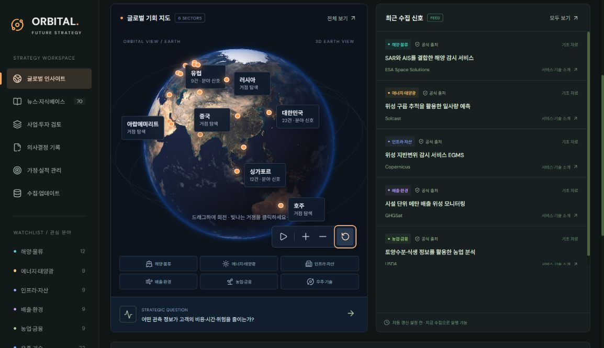

# ORBITAL · AI Solution Challenge

**화면은 `index.html`, 백엔드는 일반 JavaScript입니다. React·Next·TypeScript·번들러를 제거했습니다.**

`npm install`, `npm run dev`, 빌드 명령 없이 실행합니다. 뉴스 수집과 입력 데이터 저장에는 Node.js가 필요합니다.



## 실행

1. Node.js **22.13 이상**이 설치된 PC에서 실행합니다. 검증 환경은 Node.js 24입니다.
2. **`start.cmd`를 더블클릭**합니다.
3. 백엔드가 준비되면 브라우저에서 [http://127.0.0.1:8001](http://127.0.0.1:8001)이 열립니다.

종료할 때는 실행 창에서 `Ctrl+C`를 누릅니다. 저장 내용은 `data/orbital.sqlite`에 남아 다음 실행에도 유지됩니다.

이미 ORBITAL이 실행 중이면 `start.cmd`를 다시 눌러도 기존 서버의 화면을 엽니다. 이때 처음 실행한 서버 창은 계속 켜 두세요. 다른 프로그램이 같은 포트를 사용하면 해당 프로그램을 자동 종료하지 않고 안내합니다.

터미널로 실행하려면 다음 한 줄이면 됩니다.

```powershell
node server.js
```

`package.json`은 Node.js의 모듈 형식을 지정할 뿐이며 설치할 패키지나 실행 스크립트가 없습니다.

## 같은 와이파이·사내망에서 팀원과 사용

1. 자료를 보관할 PC 한 대에서 **`start-team.cmd`를 더블클릭**합니다. Node.js는 이 PC에만 있으면 됩니다.
2. 실행 창의 `Team access` 아래에 표시된 주소(예: `http://192.168.0.10:8001/`)를 팀원에게 전달합니다. 여러 주소가 나오면 와이파이·유선 LAN 주소를 사용합니다.
3. 팀원은 같은 네트워크에서 브라우저로 그 주소를 엽니다. HTML 파일을 각자 여는 대신 이 주소를 사용합니다.

팀원 PC에서는 실행 파일을 누를 필요가 없습니다. `127.0.0.1`은 각자 자신의 PC를 뜻하므로 팀원에게는 서버 PC의 LAN 주소를 전달합니다. 기존 서버를 `start.cmd`로 켰다면 그 서버 창에서 `Ctrl+C`로 종료하고 `start-team.cmd`로 다시 켜야 팀 접속이 가능합니다. 실행 파일을 다시 누르는 것만으로 기존 서버의 접속 범위가 바뀌지는 않습니다.

모두 서버 PC의 동일한 SQLite 자료를 읽고 수정합니다. 다른 사람의 변경은 최대 약 60초 뒤에 조회되며, 새로고침하면 바로 확인할 수 있습니다. 같은 안건을 동시에 수정하면 버전 충돌을 안내하므로 최신 내용을 확인한 뒤 다시 수정합니다. 로그인·개인별 권한은 없고 접속자는 모두 편집할 수 있으며 이력 작성자는 공통 이름으로 표시됩니다.

서버 PC와 실행 창을 켜 두어야 합니다. 종료·절전 시 팀원 접속도 끊깁니다. DB 파일을 공유 폴더에서 여러 서버로 열지 말고 서버 한 대를 사용합니다. 백업할 때는 서버를 종료한 뒤 `data` 폴더를 복사합니다.

접속되지 않으면 Windows 방화벽에서 Node.js의 **개인 네트워크** 접근을 허용했는지, 두 기기가 같은 네트워크인지 확인합니다. 사내망의 기기 간 접근 차단은 관리자 확인이 필요합니다. 공유기 포트 포워딩은 설정하지 않습니다. 이 모드는 신뢰하는 내부 팀용입니다. PC의 IP가 바뀌면 실행 창에 표시된 새 주소를 공유합니다.

터미널에서도 실행할 수 있습니다. `HOST`를 생략하면 기존처럼 내 PC에서만 접속됩니다.

```powershell
$env:HOST = "0.0.0.0"
node server.js
```

## index.html을 직접 열 때

`index.html`을 더블클릭하면 화면·지구본·저장된 뉴스 미리보기가 열립니다. 백엔드가 이미 실행 중이면 수집·저장 API도 연결됩니다. 백엔드가 꺼져 있으면 미리보기 안내가 표시되며 저장이나 실시간 수집은 실행되지 않습니다.

HTML 파일 자체가 서버 프로세스를 시작하지는 않습니다. 모든 기능을 사용하려면 `start.cmd`를 한 번 실행하면 됩니다. 이미지·아이콘·국가 좌표도 로컬에 포함했으며 CDN이나 JavaScript 모듈 로딩에 의존하지 않습니다.

## 코드를 읽는 순서

| 파일                                  | 역할                                             |
| ------------------------------------- | ------------------------------------------------ |
| **`index.html`**                      | CSS와 JavaScript를 읽는 화면의 시작점            |
| **`js/app.js`**                       | 화면 상태, 메뉴 전환, API 호출, 저장·수집 버튼   |
| **`js/views.js`**                     | 화면별 HTML 템플릿과 입력 폼                     |
| `js/config.js`                        | 사업 분야·RSS 소스·점수 기준. 서버와 화면이 공유 |
| `js/ui.js`                            | HTML 텍스트 이스케이프와 DOM 이벤트 연결         |
| `js/selectors.js`                     | 검색·필터·집계                                   |
| `js/globe.js`                         | 지구본 마우스·키보드·거점 조작                   |
| `js/globe-core.js`                    | 지구 좌표 변환과 WebGL 렌더링                    |
| **`server.js`**                       | HTTP 서버, 화면 파일 제공, API 연결              |
| `server/api.js`                       | API 경로별 분배                                  |
| `server/records.js`                   | 안건·가정·결정·실적의 저장 규칙                  |
| `server/collection.js` / `signals.js` | RSS 수집·분류·중복 제거                          |
| `server/database.js` / `sqlite.js`    | SQL 접근과 Node.js 기본 SQLite                   |
| `css/styles.css` / `globe.css`        | 전체 스타일과 지구본 스타일                      |

화면 문구는 `js/views.js`, 동작은 `js/app.js`, 분야와 가설은 `js/config.js`부터 보면 됩니다. 자세한 구조는 [구조 설명](docs/ARCHITECTURE.md)에 정리했습니다.

## 유지한 기능

- 사진 지형·구름·도시 불빛을 사용하는 지구본, 회전·거점·확대·초기화.
- 8개 공개 RSS 피드의 실제 수집과 분야별 검색·필터.
- 검토 안건 등록, 근거 연결, 점수, 단계 변경과 판단 근거.
- 가정과 목표 등록, 실적 업데이트, 변경 이력.
- SQLite 영구 저장과 JSON 내보내기.

정시 자동 수집 스케줄러는 연결하지 않았습니다. 화면의 주기적 요청은 저장된 상태를 다시 조회합니다. 현재 분석은 키워드 분류와 분야별 고정 가설이며 LLM이나 자동 사실 검증은 포함하지 않습니다.

미리보기 뉴스는 공개 RSS 자료의 저장본이며 현재 실시간 결과가 아닙니다. 지구본의 거점은 탐색용 대표 좌표이고 숫자는 국가별 기사 수가 아닌 분야 전체 수입니다.

## 검증

추가 패키지 없이 다음 명령으로 검사할 수 있습니다.

```powershell
node --test tests/*.test.mjs
node tests/workflow.mjs
```

- 자동 검사 8개: 로컬 HTML 파일 연결, 지구 좌표, 안전한 HTML 표시, HTTP·CORS, SQLite 재연결 등.
- 업무 흐름 검증 26개: 근거 연결, 수정 충돌, 의사결정, 실적 이력, 수집 중복과 부분 실패 등.
- GitHub Actions도 npm 설치 없이 같은 검사를 실행합니다.

자동 브라우저의 정책상 파일 URL 직접 열기는 검증하지 못했습니다. 동일 HTML의 HTTP 실행과 파일 Origin의 API 연결은 확인했습니다.

텍스처 출처는 [이미지 출처](assets/textures/ATTRIBUTION.md), 아이콘과 지도 데이터의 고지는 `assets/`에 있습니다. 기존 프레임워크 버전은 Git 커밋 `e2cb021`에 보존되어 있습니다.
